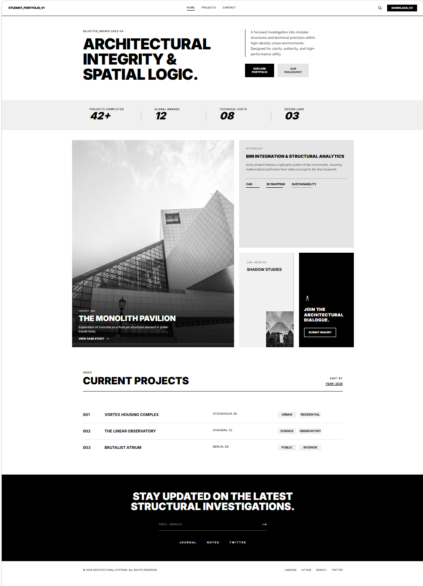

# Architectural Portfolio (Tailwind Edition)



## Overview
A high-fidelity, multi-page portfolio website built with a strict "Brutalist" architectural aesthetic. The project focuses on pixel-perfect spacing, heavy structural borders, and mathematical precision using modern CSS layout techniques.

## Custom Theme Implementation
I utilized Tailwind's @theme block in the <style> section to define CSS custom properties for my architectural portfolio's color palette. This approach allowed me to create a cohesive design system with semantic color names:
```css
@theme {
  --color-primary: #1a2332;
  --color-accent: #c75b39;
  --color-cream: #f5f1eb;
  --color-sage: #7a8b6f;
  --color-warm-gray: #d4cfc7;
  --color-deep-blue: #2d3e50;
  --color-brand-gold: #da373d;
  --color-form-bg: #dadada;
  --color-deep-charcoal: #1a1a1a;
  --color-light-gray: #f0f0f0;
  --color-mid-gray: #e5e5e5;
}
I also extended the default Tailwind theme configuration in the script section to ensure these colors were available throughout the project. The --color-cream serves as my body background, --color-primary for text, and --color-brand-gold (#da373d) as my accent/hover color for interactive elements like buttons and links.

Challenge: Creating the responsive statistics section with 4 equal columns that needed to maintain consistent borders and hover effects.
Solution: Instead of using flexbox with complex calculations or absolute positioning, I implemented CSS Grid:

<div class="grid grid-cols-2 md:grid-cols-4 border-primary">
  <div class="p-8 border-primary hover:bg-accent/10 transition-colors duration-300">
  <----->
  </div>

## Iconography and SVG Assets

For all interface icons (such as the search icon, navigation arrows, and the architectural compass), I used inline SVGs sourced and verified via SVG Viewer.
Why this approach:
Zero External Dependencies: By inlining the SVG code directly into the HTML, I eliminated the need for external icon font libraries (like FontAwesome) or additional image HTTP requests, keeping the site lightweight and fast.
Tailwind Integration: Inline SVGs allow me to style them dynamically using Tailwind CSS utility classes. For example, I can easily control their size (h-5 w-5), color (text-white, hover:text-brand-gold), and stroke width (stroke-width="2") directly in the HTML, ensuring they perfectly match the site's design system and hover states.
Crisp at Any Resolution: As vector graphics, these icons remain perfectly sharp on all devices and high-DPI (Retina) displays, which is critical for a portfolio emphasizing "technical precision" and "architectural integrity."